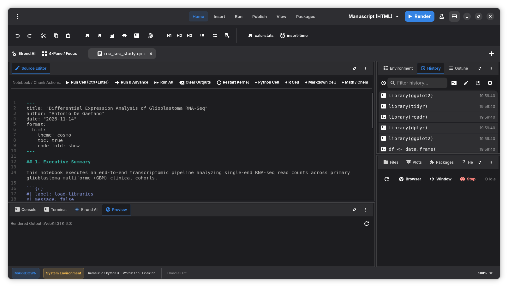
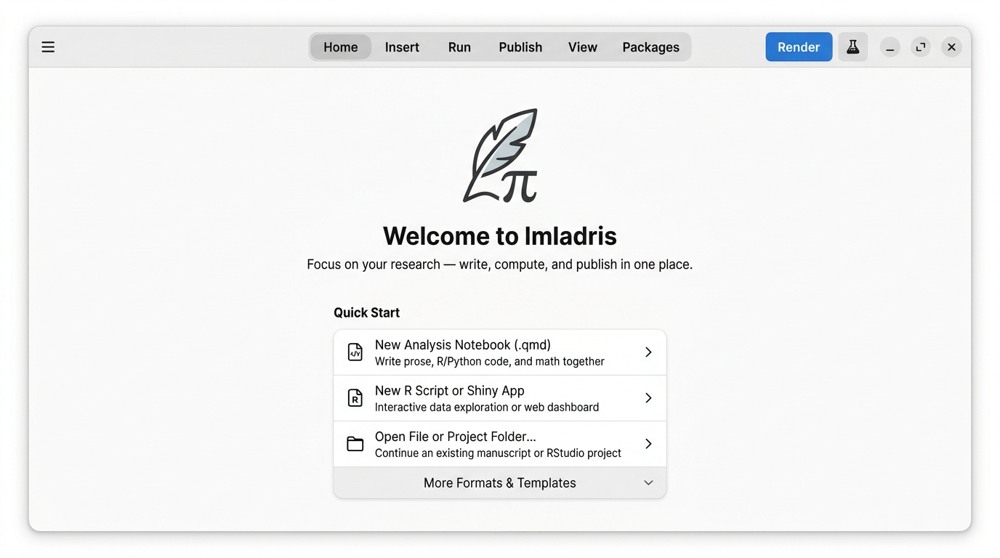
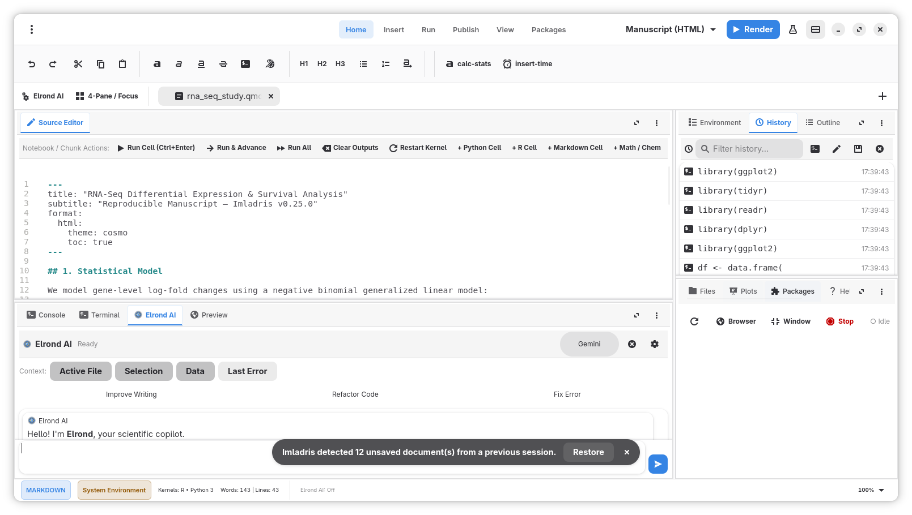
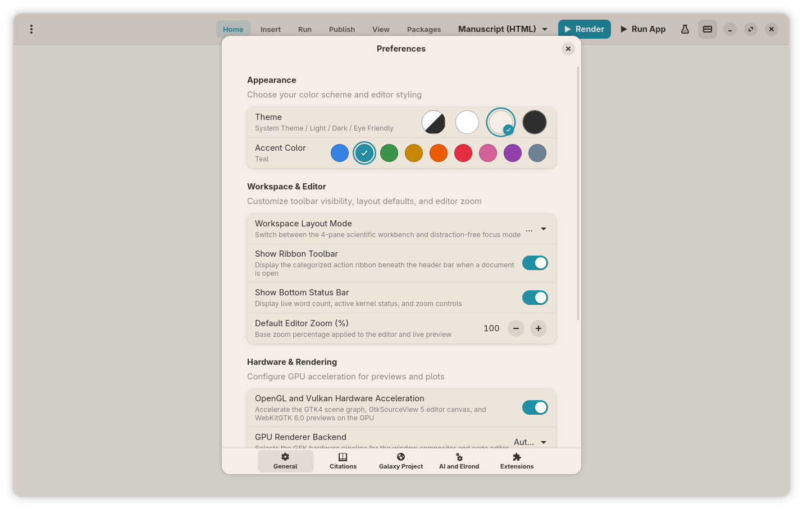

<!--
SPDX-FileCopyrightText: 2026 Antonio De Gaetano <antux912012@users.noreply.github.com>
SPDX-License-Identifier: Apache-2.0
-->

<p align="center">
  
</p>

<h1 align="center">Imladris</h1>
<h3 align="center">Native Linux Scientific Workbench &amp; Polyglot Notebook Studio</h3>

<p align="center">
  <em>Compiled Vala/GTK4 scientific IDE for biostatistics, genomics, and reproducible technical publishing—engineered for low memory overhead, offline/air-gapped governance, and cryptographic GxP provenance.</em>
</p>

<p align="center">
  <a href="https://antux912012.github.io/imladris/"></a>
  <a href="https://flatpark.org/apps/io.github.Antux912012.Imladris/"></a>
  <a href="https://github.com/Antux912012/imladris/wiki"></a>
  <a href="https://github.com/Antux912012/imladris/releases/tag/v0.42.1"></a>
  <a href="https://github.com/Antux912012/imladris-on-web"></a>
  
  
</p>

<p align="center">
  <strong><a href="https://antux912012.github.io/imladris/">Landing Page</a></strong> ·
  <strong><a href="https://github.com/Antux912012/imladris/releases/tag/v0.42.1">Download v0.42.1 (.deb / .rpm / Flatpak / AUR)</a></strong> ·
  <strong><a href="https://github.com/Antux912012/imladris-on-web">Imladris on Web (Self-Hosted)</a></strong> ·
  <strong><a href="https://github.com/Antux912012/imladris/wiki">Technical Wiki</a></strong> ·
  <strong><a href="docs/paper/imladris-scientific-paper.qmd">Scientific Paper</a></strong> ·
  <strong><a href="docs/IMLADRIS_PRODUCTION_ARCHITECTURE_BLUEPRINT.md">Production Blueprint</a></strong>
</p>

---

## Executive Summary & Technical Rationale

Scientific computing teams in pharma, biotech, academia, and regulated R&amp;D face two recurring operational bottlenecks:

1. **Workstation Resource Contention**: Electron- and JVM-based IDEs typically consume 1.2–2.5 GB of RAM at idle before loading a single dataset, competing directly with statistical models, genomic matrices, and local LLM inference.
2. **Governance &amp; Reproducibility Gaps**: Ad-hoc scripts, unpinned environments, and unverified cloud AI integrations complicate GxP audits, PHI/PII compliance, and cross-team handoffs.

**Imladris** is compiled directly to native machine code using **Vala**, **GTK4**, **Libadwaita**, **GtkSourceView 5**, and **WebKitGTK 6.0**, keeping idle memory below 120 MB and cold startup under 0.6 seconds. For teams requiring browser-based multi-user co-authoring, inline peer review, and container orchestration on lab or university servers, see the self-hosted sister project **[Imladris on Web](https://github.com/Antux912012/imladris-on-web)**.

| Operational Dimension | Electron / JVM Desktop IDEs | Imladris (`v0.42.1`) |
| :--- | :--- | :--- |
| **Idle Memory Footprint** | 1.2–2.5 GB RAM | **&lt; 120 MB RAM** (native Vala/GTK4 binary) |
| **Cold Startup Latency** | 4.0–9.0 seconds | **&lt; 0.6 seconds** |
| **AI &amp; Data Governance** | Cloud-coupled subscriptions | Local `llama.cpp`/Ollama/LM Studio, Air-Gapped Mode, PHI/PII Lock, `/etc/imladris/policy.json`, opt-in Cloud failover |
| **Workbench Ergonomics** | Fixed IDE chrome | Dual-mode: Focus Writer (`.md`/`.html`/`.rtf`) + 4-Quadrant Workbench (`.qmd`/`.Rmd`/`.ipynb`/`.R`/`.py`) |
| **Clinical &amp; Genomic Tooling** | External calculators &amp; manual downloads | **Elbereth** (ICH E9 / CDISC), **Arekyer** (Galaxy Project), **Taniquetil** (AlphaFold), **Yavanna** (UniProt/Ensembl/qPCR) |
| **Audit &amp; Portability** | Machine-local state drift | Cryptographic SHA-256 `<doc>.provenance.lock.json`, `.Rproj`, `.mallorn` bundles, `renv`/`.venv`/micromamba |

> **Trademark &amp; Affiliation Notice:** Imladris is an independent open-source software project. It is not affiliated with, sponsored by, or endorsed by Posit PBC, RStudio, Project Jupyter, or the Galaxy Project.

---

## Domain Capabilities

### Clinical Biostatistics &amp; Regulated R&amp;D
* **GxP Provenance Lockfiles**: Generates cryptographic SHA-256 provenance manifests (`<document>.provenance.lock.json`) on export.
* **Elbereth Biostatistics (`Imladris.Bridges.Elbereth`)**: ICH E9 sample size and statistical power models (Two-Sample Continuous, Proportions with Casagrande-Pike correction, Schoenfeld Log-Rank Survival) with Cairo power curves and CDISC ADSL Table 1 / ADTTE Kaplan-Meier / Cox regression code generation.
* **Enterprise Policy Controls**: Air-Gapped Mode, PHI/PII Data Lock, `/etc/imladris/policy.json` administrator lock enforcement, offline readiness verification, and explicit MCP read-only/audit controls (`IMLADRIS_MCP_READONLY=1`, `IMLADRIS_MCP_AUDIT=1`).

### Bioinformatics &amp; Structural Biology
* **Arekyer Galaxy Bridge (`Imladris.Bridges.Arekyer`)**: Connects to `usegalaxy.eu`, `usegalaxy.org`, or `usegalaxy.org.au` with `libsecret-1` credential storage to inspect history datasets and inject reproducible `httr2` / `pandas` retrieval code.
* **Taniquetil AlphaFold Bridge (`Imladris.Bridges.Taniquetil`)**: Searches AlphaFold DB / PDB structures, plots per-residue pLDDT confidence, and generates R (`bio3d`) or Python (`biotite`) analysis blocks.
* **Yavanna Bio-Entity &amp; RT-qPCR Studio (`Imladris.Bridges.Yavanna`)**: Queries UniProtKB and Ensembl GRCh38 alongside oligo length, GC%, melting temperature ($T_m$), and molecular weight calculations.

### Data Science, Polyglot Notebooks &amp; Technical Publishing
* **Dual-Mode Workbench**:
  * **Focus Mode**: Distraction-free authoring for `.md`, `.html`, and Apple TextEdit-style WYSIWYG `.rtf` (`RtfCodec` + `RtfEditorView`).
  * **Four-Quadrant Workbench (`RStudioDockGrid`)**: GtkSourceView 5 editor (Q1), persistent R/Python/Julia/SQL/Bash REPLs (Q2), Environment/Outline/Citations/Galaxy inspector (Q3), and File Browser/Cairo Plots/Packages/WebKitGTK 6.0 Preview/Shiny viewer (Q4).
* **Lossless Jupyter &amp; RStudio Parity**: Round-trip `.ipynb` (`nbformat` 4.5) preserving cell IDs, execution counts, outputs, and metadata; 1:1 `.Rproj` compatibility; `.mallorn` (`tar.zst`/`zip`) project bundles.
* **Polyglot IntelliSense &amp; Authoring Tools**: Live `refilter()` + fuzzy highlighting, `@fig-*`/`@tbl-*`/`@sec-*`/`@eq-*` cross-references, R `library()` and named argument completion, live REPL DataFrame column discovery (`$` / `.`), Quick Table Picker (`Ctrl+Alt+T`), Natural Math &amp; Chemistry (`Ctrl+M`), and bi-directional Mermaid Flow Studio (`Ctrl+Shift+D`).
* **Top 10 LaTeX Publisher &amp; Presentation Templates**: Built-in templates for IEEE, ACM (`acmart`), Springer LNCS (`llncs`), Elsevier (`elsarticle`), Nature, PLOS ONE, APS (`revtex4-2`), NeurIPS, ICML, MDPI, and Beamer/Quarto/Marp/Reveal.js/Slidev/Typst decks.
* **Multi-Format Export (`ExportService` + `export_native.c`)**: Built-in Cairo + Pango A4 vector PDF renderer, zero-dependency zlib PKZIP OASIS ODT packager, RTF serializer, and headless LaTeX/Quarto/Pandoc compilation.

### Elrond AI Copilot &amp; Local Hardware Optimization
* **Hardware Auto-Optimizer (`ElrondHardwareProbe`, `ElrondOptimizer`)**: Probes `llama-server --list-devices`, `/proc/meminfo`, and CPU cores across 5 tiers (NVIDIA, AMD, Intel Arc, iGPU, CPU), with 15-second `/health` crash recovery and automatic CPU fallback.
* **Local Offline &amp; Cloud Failover**: Manages ten curated Hugging Face GGUF presets via `llama-server` plus Ollama/LM Studio, or opt-in cloud providers (Gemini with account model discovery, Claude, OpenAI, GitHub Copilot OAuth, Groq, Cerebras, OpenRouter `:free`, GitHub Models) with HTTP 429 failover.
* **Direct Editor Writing (`Ctrl+Shift+E`)**: Streams code directly into active chunks or selections while preserving Quarto `#|` options and supporting single-step `Ctrl+Z` undo.

---

## Visual Overview

<p align="center">
  
  <em>Figure 1: Four-quadrant scientific workbench featuring live Quarto preview, interactive console, environment inspector, and Elrond AI copilot with multi-context chips.</em>
</p>

<table width="100%">
  <tr>
    <td width="50%" align="center">
      <br>
      <em>Figure 2: Welcome screen with quick-start actions and templates.</em>
    </td>
    <td width="50%" align="center">
      <br>
      <em>Figure 3: Direct Editor Writing with in-place chunk updates and Quarto option preservation.</em>
    </td>
  </tr>
  <tr>
    <td width="50%" align="center">
      <br>
      <em>Figure 4: Workspace and editor preferences (4-Pane vs Focus mode, ribbon toggle, zoom).</em>
    </td>
    <td width="50%" align="center">
      <br>
      <em>Figure 5: GNOME system themes, Eye Friendly mode, and accent color selection.</em>
    </td>
  </tr>
</table>

---

## Architecture &amp; Module Map

```text
+-----------------------------------------------------------------------+
|                       GTK4 / Libadwaita UI Layer                      |
|  Window (HeaderBar + Ribbons + 4-Pane RStudioDockGrid + StatusBar)    |
+-----------------------------------+-----------------------------------+
                                    |
        +---------------------------+---------------------------+
        v                           v                           v
+---------------+           +---------------+           +---------------+
|  DocumentPage |           |   Elrond AI   |           |  Domain UI    |
| (GtkSource 5) |           | (Chat/Copilot)|           | (Bridges/Viz) |
+-------+-------+           +-------+-------+           +-------+-------+
        |                           |                           |
        v                           v                           v
+-----------------------------------------------------------------------+
|                       Core, Bridges &amp; Services                        |
|  DocumentAdapter · AiBufferEditHelper · MallornManager · ChunkParser  |
|  HostBridge · EnvDiscovery · ExecutionRouter · ProvenanceAttestation  |
|  AiConfigManager · AiClient · CopilotAuthService · McpServer (D-Bus)  |
|  PersistentSessionManager · SandboxController · ExportService         |
|  Arekyer · Yavanna · Taniquetil · Elbereth · ZoteroService            |
+-----------------------------------------------------------------------+
```

* **Technical Wiki**: [Home](docs/wiki/Home.md) · [Arekyer Bridge](docs/wiki/Galaxy-to-Quarto-Bridge.md) · [Math &amp; Chem Studio](docs/wiki/Math-and-Chemical-Studio.md) · [Projects &amp; Sandboxing](docs/wiki/Projects-and-Sandboxing.md) · [Elrond AI Copilot](docs/wiki/Elrond-Local-AI-Copilot.md) · [Plugin Development](docs/wiki/Plugin-Development-Guide.md)
* **Specifications**: [ASD-STE100 Functional Description](docs/ASD_STE100_FUNCTIONAL_DESCRIPTION.md) · [Architecture](docs/ARCHITECTURE.md) · [Docking Architecture](docs/DOCKING_ARCHITECTURE.md) · [Changelog](CHANGELOG.md)

---

## Installation &amp; Deployment

### Universal Quick Install (Linux Distributions &amp; Flatpak)
```bash
curl -fsSL https://antux912012.github.io/imladris/install.sh | bash
```

### Flatpak / Flatpark (Recommended)
```bash
flatpak remote-add --if-not-exists flatpark https://dl.flatpark.org/flatpark.flatpakrepo
flatpak install flatpark io.github.Antux912012.Imladris
flatpak run io.github.Antux912012.Imladris
```

#### Flatpak Sandbox &amp; Linter Verification
Imladris targets `org.gnome.Platform//47` with minimal static permissions (`--share=ipc`, `--socket=fallback-x11`, `--socket=wayland`, `--device=dri`, `--share=network`, `--filesystem=xdg-documents`, `--filesystem=xdg-download`; all other paths use `Gtk.FileDialog` / `org.freedesktop.portal.FileChooser`):
```bash
flatpak run --filesystem=host --command=flatpak-builder-lint org.flatpak.Builder manifest io.github.Antux912012.Imladris.yml
flatpak run --filesystem=host --command=flatpak-builder-lint org.flatpak.Builder appstream data/io.github.Antux912012.Imladris.metainfo.xml
```

### Native Packages (`.deb`, `.rpm`, AUR, Solus, NixOS)
Pre-built packages are available on [GitHub Releases v0.42.1](https://github.com/Antux912012/imladris/releases/tag/v0.42.1):

```bash
# Debian / Ubuntu / elementary OS (includes integrated toolchain dependencies):
sudo apt install ./imladris_0.42.1_amd64.deb

# Fedora / RHEL / CentOS / AlmaLinux:
sudo dnf install ./imladris-0.42.1-1.fc44.x86_64.rpm

# openSUSE:
sudo zypper install ./imladris-0.42.1-1.fc44.x86_64.rpm

# Arch Linux (AUR):
paru -S imladris

# NixOS (Flakes):
nix run github:Antux912012/imladris
```

- **Solus (`ypkg`)**: [`packaging/package.yml`](packaging/package.yml)
- **Flatpak Toolchain Extension**: `flatpak install io.github.Antux912012.Imladris.Toolchain.flatpak`

### Build from Source (Meson &amp; Ninja)
Requires `valac >= 0.56`, `meson >= 0.60`, `ninja`, `gtk4 >= 4.12`, `libadwaita-1 >= 1.5`, `gtksourceview-5 >= 5.10`, `webkitgtk-6.0 >= 2.40`, `javascriptcoregtk-6.0`, `libsoup-3.0`, `json-glib-1.0`, `libsecret-1`, and `libgee-0.8`:

```bash
git clone https://github.com/Antux912012/imladris.git
cd imladris
meson setup build-release --buildtype=release
meson compile -C build-release
GSETTINGS_BACKEND=memory meson test -C build-release --print-errorlogs
./build-release/imladris
```

### Reproducible Container Build (Docker Compose / Podman)
```bash
docker compose run --rm imladris-build   # Compile and run all Meson test suites
docker compose run --rm imladris-rpm     # Build .rpm and .src.rpm packages
docker compose run --rm imladris-dev     # Interactive Fedora build shell
```

---

## CLI &amp; Keyboard Shortcuts

```bash
imladris --help              # Display CLI arguments
imladris --version           # Output installed version
imladris --mcp-server        # Run stdio Model Context Protocol (MCP) server (D-Bus bridge)
imladris --purge-user-data   # Purge local config, cache, and keyring entries (GDPR Art. 17)
imladris document.qmd        # Open document, notebook, .Rproj, or .mallorn archive
```

| Shortcut | Action |
| :--- | :--- |
| `Ctrl+N` / `Ctrl+O` / `Ctrl+S` | New Document/Project, Open, Save |
| `Ctrl+Shift+E` | Elrond Direct Editor Writing |
| `Ctrl+M` | Natural Math &amp; Chemical Reaction Studio |
| `Ctrl+Shift+D` | Visual Flow &amp; Mindmap Studio |
| `Ctrl+Alt+T` | Quick Table Picker Popover |
| `Ctrl+Space` | Contextual Polyglot IntelliSense |
| `Ctrl+Enter` / `Ctrl+Shift+Enter` | Execute Line/Selection or Active Chunk |
| `Ctrl+Shift+A` | Run / Stop Embedded R Shiny Application |
| `Ctrl+F1` / `Ctrl+Comma` | Toggle Ribbon Toolbar / Preferences |

---

## Security, Privacy &amp; Commercial Open-Core Licensing

* **Zero Telemetry ([`PRIVACY.md`](PRIVACY.md))**: No telemetry pings, crash uploads, or background network calls on launch.
* **Credential &amp; Plugin Security ([`SECURITY.md`](SECURITY.md))**: API keys and OAuth tokens are stored via `libsecret-1` with `0600` fallbacks. Community `.implugin` extensions undergo archive validation, permission-subset checks, and `realpath()` asset confinement.
* **MCP Guardrails**: Code execution via MCP is disabled by default (`IMLADRIS_MCP_ALLOW_EXEC=1` required), enforces `IMLADRIS_MCP_WORKSPACE` boundary checks, and supports `IMLADRIS_MCP_READONLY=1` and `IMLADRIS_MCP_AUDIT=1` JSONL logging.
* **GDPR Art. 17**: `imladris --purge-user-data` removes all local configuration, caches, and keyring entries.
* **AI &amp; Flathub Disclosure ([`docs/FLATHUB_AI_DISCLOSURE_AND_SUBMISSION.md`](docs/FLATHUB_AI_DISCLOSURE_AND_SUBMISSION.md))**: Architected, reviewed, and tested by Antonio De Gaetano with AI pair-programming assistance (Google Gemini and Anthropic Claude across ~60–70% of scaffolding, refactoring, and documentation). Flatpak manifests are human-maintained and verified via `flatpak-builder-lint`.
* **Apache-2.0 Open-Core Model**: Core desktop studio is licensed under **[Apache License 2.0 (`Apache-2.0`)](LICENSE)** ([`NOTICE`](NOTICE)) with explicit patent protection. Third-party `.implugin` (`JSC.Context`) and out-of-process MCP (`McpServer`) integrations may use any license; Commercial Enterprise Packs (OIDC SSO, centralized GxP audit/policy management, and proprietary LIMS/ELN connectors) are licensed separately.

```text
SPDX-FileCopyrightText: 2026 Antonio De Gaetano <antux912012@users.noreply.github.com>
SPDX-License-Identifier: Apache-2.0
```
