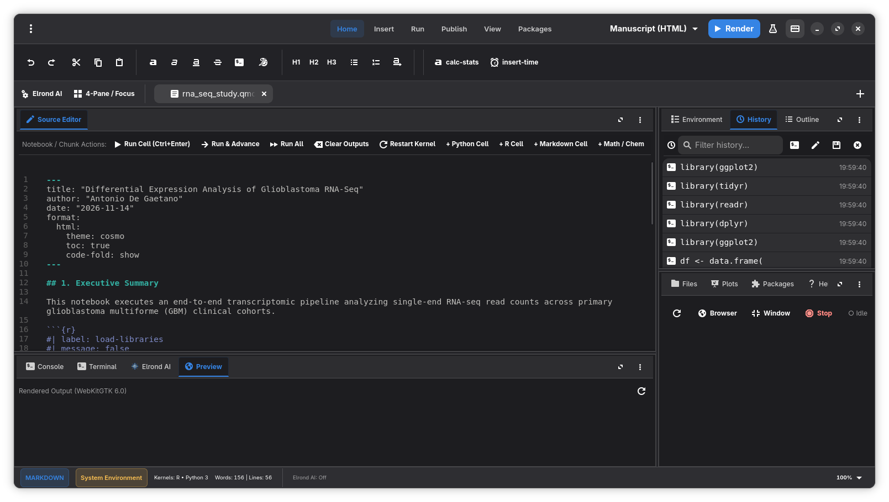
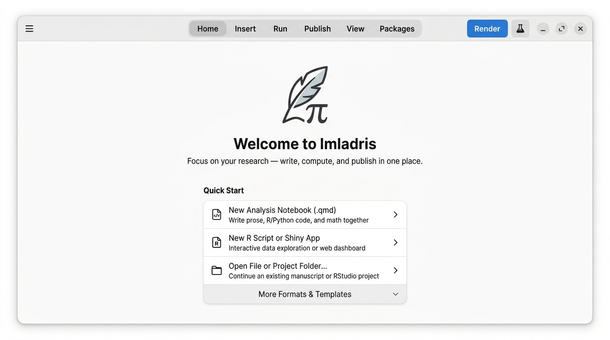
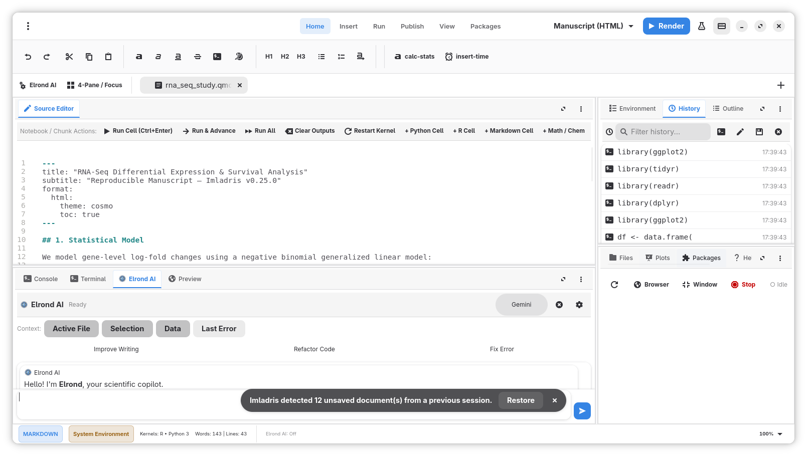
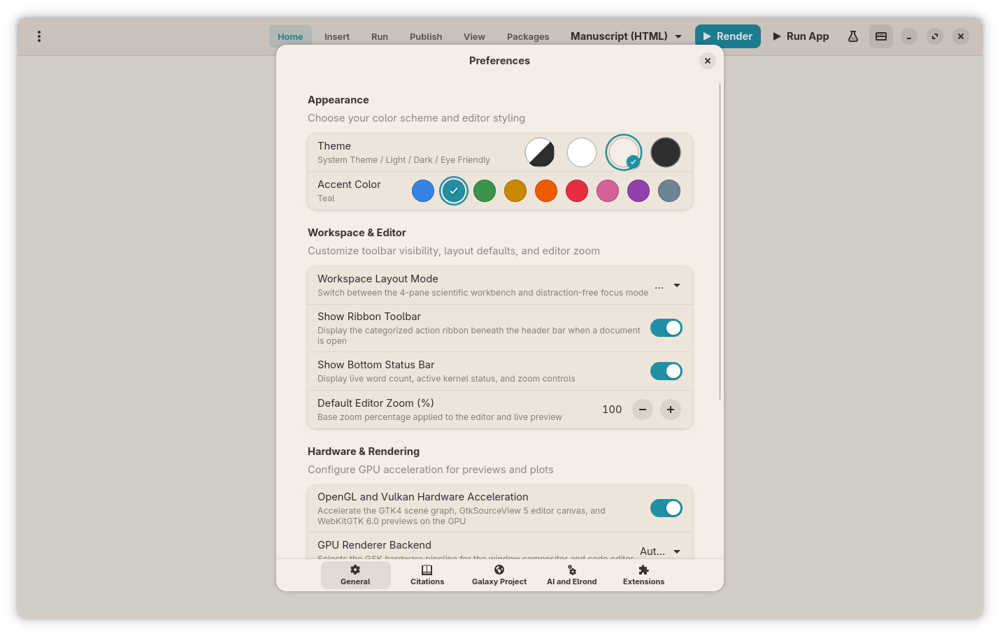

<!--
SPDX-FileCopyrightText: 2026 Antonio De Gaetano <antux912012@users.noreply.github.com>
SPDX-License-Identifier: GPL-3.0-or-later
-->

<p align="center">
  
</p>

<h1 align="center">Imladris</h1>
<h3 align="center">Native Linux Scientific Workbench, Bioinformatics Bridge & Polyglot Notebook IDE</h3>

<p align="center">
  <a href="https://antux912012.github.io/imladris/"></a>
  <a href="https://flatpark.org/apps/io.github.Antux912012.Imladris/"></a>
  <a href="https://github.com/Antux912012/imladris/wiki"></a>
  <a href="https://github.com/Antux912012/imladris/releases"></a>
  
  
  
</p>

<p align="center">
  <strong><a href="https://antux912012.github.io/imladris/">🌐 Visit the Official Landing Page</a></strong> ·
  <strong><a href="https://flatpark.org/apps/io.github.Antux912012.Imladris/">📦 Install from Flatpark</a></strong> ·
  <strong><a href="https://github.com/Antux912012/imladris/wiki">📖 Read the Technical Wiki</a></strong> ·
  <strong><a href="docs/IMLADRIS_PRODUCTION_ARCHITECTURE_BLUEPRINT.md">🏗️ Production Blueprint</a></strong> ·
  <strong><a href="https://github.com/Antux912012/imladris/releases/tag/v0.23.0">⬇️ Download v0.23.0 (.deb / .rpm / Flatpak / AUR)</a></strong>
</p>

---

## 1. Technical Summary

**Imladris** is a native Linux scientific document studio, bioinformatics data bridge, and polyglot notebook IDE. Engineered in compiled **Vala** with **GTK4**, **Libadwaita**, **GtkSourceView 5**, and **WebKitGTK 6.0**, Imladris eliminates Electron overhead so workstation memory and CPU resources remain dedicated to statistical compute, genomic alignments, and local AI inference.

The application transitions dynamically between two editing layouts:
* **Single-Pane Writer Mode**: Loads lightweight Markdown (`.md`) and HTML (`.html`) files in a distraction-free authoring view without spawning background language interpreters.
* **Four-Quadrant Workbench Mode**: Loads computational documents (`.qmd`, `.Rmd`, `.ipynb`, `.R`, `.py`) into a configurable RStudio-style 4-quadrant layout featuring interactive REPL consoles, variable environment inspectors, native **Arekyer Galaxy Project** history browsers, Zotero citation engines, and live WebKitGTK 6.0 previews.

> **Note:** Imladris is an independent open-source software project. It is not affiliated with, sponsored by, or endorsed by Posit PBC, RStudio, Project Jupyter, or the Galaxy Project.

---

## 2. Visual Overview & Screenshots

<p align="center">
  
  <em>Figure 1: Four-quadrant scientific workbench featuring live Quarto preview, interactive console, environment inspector, and redesigned Elrond AI copilot with multi-context chips.</em>
</p>

<table width="100%">
  <tr>
    <td width="50%" align="center">
      <br>
      <em>Figure 2: Streamlined Welcome screen with Quick Start actions and expandable templates row.</em>
    </td>
    <td width="50%" align="center">
      <br>
      <em>Figure 3: Preview-first inline code assistance with instant syntax-highlighted code preview.</em>
    </td>
  </tr>
  <tr>
    <td width="50%" align="center">
      <br>
      <em>Figure 4: Workspace &amp; Editor preferences (4-Pane vs Focus mode, ribbon toggle, zoom).</em>
    </td>
    <td width="50%" align="center">
      <br>
      <em>Figure 5: GNOME system themes, Eye Friendly mode, and custom accent color selection.</em>
    </td>
  </tr>
</table>

---

## 3. Key Features

* **GNOME / Libadwaita HIG Overhaul & Zero-Chrome Empty State**: Streamlines the initial user experience with progressive disclosure. Features a clean **Quick Start** card row (*Quarto Notebook*, *R Script or Shiny App*, *Open File or Folder*) and a collapsible **More Formats & Templates** expander (*.Rmd*, *.ipynb*, *.Rproj*, *.mallorn*). When no document is open, the ribbon bar, tab bar, and status bar automatically hide for a calm distraction-free experience.
* **Redesigned Elrond AI Copilot & Code Assistance**: Interactive scientific copilot tab with a persistent active provider pill button (*Elrond Local*, *Gemini*, *Claude*, *OpenAI*, *DeepSeek*, *Kimi*, *Qwen*, *Ollama*, *LM Studio*), context chips (*Active File*, *Selection*, *Data*, *Last Error*), Pango-formatted markdown responses, and interactive code cards (*Insert at Cursor*, *Run in Console*, *Copy*).
* **Preview-First Inline Code Assistance (`Ctrl+Shift+E`)**: Context-aware popover floating over the editor with one-click quick prompt pills (*Fix & Clean*, *Add Comments*, *Explain*, *R Plot*) and a live monospace preview box with *Replace Selection*, *Insert at Cursor*, and *Regenerate* controls.
* **Workspace & Editor Preferences**: New dedicated settings in Preferences for switching between **4-Pane Studio** and **Focus Mode**, toggling ribbon toolbar visibility, toggling the bottom status bar, and customizing default zoom percentage (paired with a compact status bar zoom popover).
* **Elbereth Clinical Biostatistics, Power & Survival Studio (`Imladris.Bridges.Elbereth`)**: Native HeaderBar studio for clinical trialists, biostatisticians, and translational researchers. Computes **ICH E9 Statistical Power & Sample Size** for Two-Sample Continuous ($t$-test / Cohen's $d$), Two-Sample Proportions ($p_1$ vs. $p_2$ with Casagrande-Pike continuity correction), and Time-to-Event Survival (**Schoenfeld 1983 Log-Rank Hazard Ratio formula**) with attrition adjustment. Draws a live **Cairo Power Curve ($1-\beta$ vs. $N$)** and injects regulatory SAP justifications alongside R and Python verification chunks. Generates publication-ready code blocks for **CDISC ADSL Table 1**, **ADTTE Kaplan-Meier & Cox PH**, **Subgroup Forest Plots**, and **Differential Expression Volcano Plots**.
* **Arekyer Galaxy-to-Quarto Provenance Bridge (`Imladris.Bridges.Arekyer`)**: Connects upstream cloud bioinformatics histories (**Galaxy Project**, such as `usegalaxy.eu`, `usegalaxy.org`, `usegalaxy.org.au`) directly to local reproducible `.qmd` and `.Rmd` manuscripts. Injects standardized R (`httr2` / `readr`) and Python (`requests` / `pandas`) data-fetching code blocks with verifiable dataset UUID/HID headers. Stores Galaxy API keys exclusively in the OS keyring (`libsecret-1` / `org.freedesktop.Secret.Service`) and injects `GALAXY_API_KEY` into isolated compilation subprocesses.
* **Taniquetil AlphaFold Structural Biology Bridge (`Imladris.Bridges.Taniquetil`)**: Inspects 3D macromolecular structures from the DeepMind / EMBL-EBI **AlphaFold Protein Structure Database** (AFDB) and RCSB PDB directly from the header bar. Renders an interactive Cairo per-residue **pLDDT confidence distribution track** (`#0053D6` Very High, `#65CBF3` Confident, `#FFDB13` Low, `#FF7D45` Disordered) and injects reproducible **R (`bio3d`)** and **Python (PAE matrix / `biotite`)** code blocks into manuscripts.
* **Yavanna Bio-Entity Resolver & RT-qPCR Primer Calculator (`Imladris.Bridges.Yavanna`)**: Resolves UniProtKB protein accessions and Ensembl GRCh38 gene coordinates asynchronously via `libsoup-3.0` and `json-glib-1.0`. Computes DNA/RNA sequence length, GC content, Melting Temperature ($T_m$), and Molecular Weight in memory and injects verified reverse-complement tables.
* **Cryptographic GxP & EU Cyber Resilience Act (CRA) Provenance Attestation**: Computes SHA-256 digests across the source manuscript, environment lockfiles (`renv.lock`, `uv.lock`, `environment.yml`, `_quarto.yml`), and extracted bio-entity records, writing a verifiable `<document>.provenance.lock.json` sidecar manifest upon every compilation and via the Publish ribbon **GxP Lock** button.
* **Natural Math & Chemical Reaction Studio (`Ctrl+M`)**: Translates human-readable mathematical expressions (for example, `(-b +- sqrt(b^2 - 4*a*c)) / (2*a)`, `int(0, inf) e^(-x^2) dx`) and chemical equations (for example, `6CO2(g) + 6H2O(l) ->[h*nu][chlorophyll] C6H12O6(aq) + 6O2(g)`, `[Fe(CN)6]^4-`) into **LaTeX** (`$$...$$`, `$...$`, `\ce{...}`, `\begin{equation}`, `\begin{align}`) or **Markdown** (`~sub~` / `^sup^` and Unicode scientific notation) with instant offline preview.
* **Visual Flow & Mindmap Studio (`Ctrl+Shift+D`)**: Interactive Cairo 2D vector canvas (inspired by draw.io and MindNode) for graphically designing **Flowcharts**, **Mindmaps**, **Sequence Diagrams**, and **State Machines** using drag-and-drop shapes, interactive connection ports, semantic GNOME color palettes, swimlane subgraphs, and two-way synchronization with Quarto ` ```{mermaid} ` and Markdown ` ```mermaid ` code blocks.
* **Reproducible Project Environments & Native `.Rproj` Scaffolding**: Creates and synchronizes standard RStudio `.Rproj` project manifests alongside portable `.mallorn` bundles (`tar.zst`), managing isolated `renv` (R) and `.venv` (Python) sandboxes with automatic `pwd` root locking.
* **Jupyter Notebook (`nbformat 4.5`) Full Parity**: Provides lossless round-trip serialization of `.ipynb` files—preserving cell IDs, execution counts, cell tags, arbitrary cell metadata, raw cells, and kernel specifications—paired with `Shift+Enter` cell execution and cursor advancement.
* **Adaptive Four-Quadrant Workbench**: Configurable RStudio-style docking across Source Editor (Q1), Console & Terminal (Q2), Environment / History / Outline / Citations / Arekyer Galaxy Bridge (Q3), and Files / Plots / Packages / Help / Live Preview / Shiny Viewer (Q4).
* **Polyglot Execution Engines**: Executes code chunks in R, Python, Julia, SQL, and Bash through persistent stateful REPL bridges (`ReplBridge`) with inline stdout/stderr cards and high-DPI plot capture.
* **Interactive Dataframe Viewer**: Inspects R `data.frame` / `tibble` and Python `pandas.DataFrame` objects using `Gtk.ColumnView` with column sorting, regex filtering, pagination, and CSV clipboard export.
* **R Shiny Reactive Web Application Support**: Detects `app.R`, `server.R`/`ui.R`, and `runtime: shiny` notebooks; launches Shiny servers on ephemeral ports (`Ctrl+Shift+A`) and renders live outputs in Quadrant 4, a dedicated `Adw.Window`, or an external browser.
* **Zotero Citation Engine**: Reads local BetterBibTeX (`.bib`) and CSL-JSON libraries with live `@citekey` autocompletion in the editor.
* **Local Elrond AI Copilot & Multi-Provider Cloud AI**: Connects to local inference servers (`llama-server`, Ollama, LM Studio) on loopback (`127.0.0.1`) or cloud providers (Gemini, Claude, OpenAI, DeepSeek, Kimi, Qwen) for context-aware code synthesis.
* **Publication Export Pipeline**: Renders manuscripts and slide decks to PDF, standalone HTML5, OpenDocument Text (`.odt`), and OpenDocument Presentation (`.odp`) via Quarto, Pandoc, and headless LibreOffice.
* **Model Context Protocol (MCP) Server**: Exposes a JSON-RPC 2.0 stdio server (`imladris --mcp-server`) for agentic tool use and automated document inspection.

---

## 3. Feature Highlights

### 3.1 Arekyer: Galaxy-to-Quarto Provenance Bridge (`WIKI 02`)
Manual downloads of tabular files from Galaxy break the chain of provenance between cloud alignments and published figures. From the **Arekyer Bridge** panel, clicking **[ + R ]** or **[ + Py ]** on any Galaxy dataset inserts a self-contained provenance block at the cursor:

````markdown
```{r arekyer-galaxy-43, message=FALSE}
# AREKYER PROVENANCE RECORD
# Server: https://usegalaxy.eu
# History ID: bbd44e69cb8906b5
# Dataset ID: f2db41e1fa331b3e (HID: 43 | Format: tabular)

galaxy_url <- "https://usegalaxy.eu/api/histories/bbd44e69cb8906b5/contents/f2db41e1fa331b3e/display"
req <- httr2::request(galaxy_url) |>
  httr2::req_headers("x-api-key" = Sys.getenv("GALAXY_API_KEY"))
resp <- httr2::req_perform(req)
galaxy_df_43 <- readr::read_tsv(httr2::resp_body_raw(resp), show_col_types = FALSE)
head(galaxy_df_43)
```
````

### 3.2 Natural Math & Chemical Reaction Studio (`Ctrl+M`)
Write mathematical formulas and chemical reactions naturally without memorizing verbose LaTeX macros:

| Domain | Natural Input Syntax | LaTeX Output (`$$...$$` / `\ce{...}`) | Markdown Output |
| :--- | :--- | :--- | :--- |
| **Mathematics** | `(-b +- sqrt(b^2 - 4*a*c)) / (2*a)` | `\frac{-b \pm \sqrt{b^{2} - 4 \cdot a \cdot c}}{2 \cdot a}` | `(-b ± √(b^2^ - 4·a·c)) / (2·a)` |
| **Calculus** | `int(0, inf) e^(-x^2) dx = sqrt(pi)/2` | `\int_{0}^{\infty} e^{-x^{2}} \, dx = \frac{\sqrt{\pi}}{2}` | `∫~0~^∞^ e^-x^2^^ dx = √(π)/2` |
| **Chemistry** | `6CO2(g) + 6H2O(l) ->[h*nu] C6H12O6(aq) + 6O2(g)` | `$$\ce{6CO2(g) + 6H2O(l) ->[h\nu] C6H12O6(aq) + 6O2(g)}$$` | `6CO~2~(g) + 6H~2~O(l) →[hν] C~6~H~12~O~6~(aq) + 6O~2~(g)` |
| **Electrochemistry** | `Fe^3+ + e- <=> Fe^2+` | `$$\ce{Fe^{3+} + e^- <=> Fe^{2+}}$$` | `Fe^3+^ + e^-^ ⇌ Fe^2+^` |

---

## 4. System Architecture

Imladris separates UI presentation, core domain parsers, security bridges, and execution services:

```text
+-----------------------------------------------------------------------+
|                           User Interface                              |
|   +-------------------+  +-------------------+  +-----------------+   |
|   |   Adw.Window      |  |  RibbonFactory    |  | RStudioDockGrid |   |
|   |  (Header & Tabs)  |  |  (Context Tabs)   |  | (4 Quadrants)   |   |
|   +-------------------+  +-------------------+  +-----------------+   |
|            |                      |                      |            |
|   +---------------------------------------------------------------+   |
|   |   DocumentPage, PersistentPanelRegistry & MathChemStudio      |   |
+---+---------------------------------------------------------------+---+
                                    |
+-----------------------------------+-----------------------------------+
|                        Core Domain & Bridges                          |
|   +-------------------+  +-------------------+  +-----------------+   |
|   |  MathChemEngine   |  |   ArekyerBridge   |  |  Serializer     |   |
|   | (LaTeX/mhchem/MD) |  | (Galaxy + Secret) |  | (.qmd/.ipynb)   |   |
|   +-------------------+  +-------------------+  +-----------------+   |
|            |                      |                      |            |
|   +-------------------+  +-------------------+  +-----------------+   |
|   |  DocumentAdapter  |  |   MallornManager  |  |  ChunkParser    |   |
|   |  (HTML / Preview) |  | (.mallorn/.Rproj) |  | (Fenced AST)    |   |
+---+-------------------+--+-------------------+--+-----------------+---+
                                    |
+-----------------------------------+-----------------------------------+
|                        Services & Execution                           |
|   +-------------------+  +-------------------+  +-----------------+   |
|   |    ReplBridge     |  |   ShinyService    |  | SandboxController|  |
|   | (R / Python PTY)  |  | (Ephemeral Ports) |  |  (renv / .venv) |   |
|   +-------------------+  +-------------------+  +-----------------+   |
|            |                      |                      |            |
|   +-------------------+  +-------------------+  +-----------------+   |
|   |   ExportService   |  |   ZoteroService   |  | PlatformUtils   |   |
|   |  (Quarto/Pandoc)  |  |  (BibTeX / CSL)   |  | (Keyring/Spawn) |   |
+---+-------------------+--+-------------------+--+-----------------+---+
```

### Module Responsibilities:
* `Imladris.UI`: Manages GTK4 and Libadwaita window components, 4-quadrant docking grids, ribbons, and modal dialogs (`MathChemEditorDialog`, `RprojDialog`, `GalaxyPanel`, `GalaxyAuthDialog`).
* `Imladris.Core`: Implements natural math/chemistry parsing (`MathChemEngine`), `.ipynb` `nbformat 4.5` serialization (`NotebookSerializer`), `.Rproj` / `.mallorn` project scaffolding (`MallornManager`, `ProjectScaffolder`), and runtime resolution (`PlatformUtils`, `ToolchainManager`).
* `Imladris.Bridges.Arekyer`: Connects to remote Galaxy REST APIs (`GalaxyClient`), stores credentials in `libsecret-1`, synthesizes provenance code blocks (`GalaxyChunkGenerator`), and injects credentials into compilation subprocesses (`ArekyerBridge`).
* `Imladris.Execution` & `Imladris.Services`: Operates stateful REPL subprocess pipes (`ReplBridge`), Shiny reactive web servers (`ShinyService`), Zotero bibliography indexing (`ZoteroService`), and crash-safe shadow snapshots (`RecoveryService`).

---

## 5. Documentation & Resources

* 🌐 **[Official Project Landing Page](https://antux912012.github.io/imladris/)**: Interactive feature overview, 4-quadrant workbench preview, and release downloads.
* 📖 **[GitHub Technical Wiki](https://github.com/Antux912012/imladris/wiki)**: Complete user and developer documentation authored in ASD-STE100 Simplified Technical English:
  * [Home & Feature Matrix](docs/wiki/Home.md)
  * [WIKI 02 // Arekyer: Galaxy-to-Quarto Provenance Bridge](docs/wiki/Galaxy-to-Quarto-Bridge.md)
  * [Math & Chemical Reaction Studio Guide](docs/wiki/Math-and-Chemical-Studio.md)
  * [Projects, `.Rproj` Scaffolding & Sandboxing](docs/wiki/Projects-and-Sandboxing.md)
  * [`.mallorn` Format, RStudio & Jupyter `nbformat 4.5` Parity](docs/wiki/Mallorn-Format-and-RStudio.md)
  * [Packages Ribbon Manager (CRAN & PyPI)](docs/wiki/Packages-Ribbon-Manager.md)
  * [Elrond Local AI Copilot](docs/wiki/Elrond-Local-AI-Copilot.md)
  * [Exporting to PDF, HTML, ODT & ODP](docs/wiki/Exporting-ODT-ODP-PDF.md)
  * [Plugin Development Guide (`.implugin`)](docs/wiki/Plugin-Development-Guide.md) & [Plugin API Reference](docs/wiki/Plugin-API-Reference.md)
* 🏗️ **[Architectural Blueprint (`docs/ARCHITECTURE.md`)](docs/ARCHITECTURE.md)**: Component connection map, sequence diagrams, and bug localization matrix.
* 🪟 **[Docking Architecture (`docs/DOCKING_ARCHITECTURE.md`)](docs/DOCKING_ARCHITECTURE.md)**: Specification of the 4-quadrant RStudio workbench layout engine.

---

## 6. Prerequisites and Dependencies

### Toolchain Requirements:
* Vala compiler: `valac` >= 0.56.0
* C compiler: `gcc` or `clang`
* Build system: `meson` >= 0.60.0 and `ninja`

### Required Libraries:
* `gtk4` >= 4.12
* `libadwaita-1` >= 1.5
* `gtksourceview-5` >= 5.10
* `webkitgtk-6.0` >= 2.40
* `javascriptcoregtk-6.0` >= 2.40
* `libsoup-3.0` >= 3.0
* `json-glib-1.0` >= 1.6
* `libsecret-1` >= 0.20
* `libgee-0.8` >= 0.20
* `gio-2.0` / `glib-2.0` >= 2.76

### Distribution Package Commands:

**Fedora / RHEL / CentOS Stream:**
```bash
sudo dnf install vala meson ninja-build gcc \
    gtk4-devel libadwaita-devel gtksourceview5-devel \
    webkitgtk6.0-devel libsoup3-devel json-glib-devel \
    libsecret-devel libgee-devel
```

**Debian (Bookworm / Trixie) / Ubuntu (24.04 LTS+):**
```bash
sudo apt update
sudo apt install valac meson ninja-build gcc \
    libgtk-4-dev libadwaita-1-dev libgtksourceview-5-dev \
    libwebkitgtk-6.0-dev libsoup-3.0-dev libjson-glib-dev \
    libsecret-1-dev libgee-0.8-dev
```

**Arch Linux:**
```bash
sudo pacman -S vala meson ninja gcc \
    gtk4 libadwaita gtksourceview5 webkitgtk-6.0 \
    libsoup3 json-glib libsecret libgee
```

---

## 7. Build and Installation Instructions

### Installation via Flatpark & Flatpak:
Imladris is officially distributed on [Flatpark](https://flatpark.org/apps/io.github.Antux912012.Imladris/) (the open Flatpak application repository, [flatpark/flatpark](https://github.com/flatpark/flatpark)).

### Package Installation:

#### Flatpark / Flatpak:
```bash
# Add the Flatpark repository
flatpak remote-add --if-not-exists flatpark https://flatpark.org/repo/flatpark.flatpakrepo

# Install Imladris from Flatpark
flatpak install flatpark io.github.Antux912012.Imladris

# Run Imladris
flatpak run io.github.Antux912012.Imladris
```

#### Arch Linux (AUR):
```bash
paru -S imladris
# or using yay:
yay -S imladris
```

#### Fedora / RHEL (.rpm):
```bash
sudo dnf install ./imladris-0.24.0-1.x86_64.rpm
```

#### Debian / Ubuntu (.deb):
```bash
sudo dpkg -i imladris_0.24.0_amd64.deb
sudo apt-get install -f
```

#### AppImage (`.AppImage`):
```bash
chmod +x ./Imladris-0.24.0-x86_64.AppImage
./Imladris-0.24.0-x86_64.AppImage
```

Standalone packages and bundles (`.flatpak`, `.deb`, `.rpm`, `.AppImage`, and source `.tar.gz`) are available on [Flatpark](https://flatpark.org/apps/io.github.Antux912012.Imladris/) and [GitHub Releases v0.24.0](https://github.com/Antux912012/imladris/releases/tag/v0.24.0).

### Debug Profile Build & Verification:
```bash
git clone https://github.com/Antux912012/imladris.git
cd imladris
meson setup build-debug --buildtype=debug
meson compile -C build-debug
meson test -C build-debug --print-errorlogs
./build-debug/imladris
```

### Optimized Release Profile Build:
```bash
meson setup build-release --buildtype=release --strip
meson compile -C build-release
sudo meson install -C build-release
```

### Automated Packaging Scripts:
* Generate Flatpak bundle and Debian `.deb` package: `./build-packages.sh`
* Generate Fedora `.rpm` package: `./build-rpm.sh`
* Generate SPDX Software Bill of Materials (SBOM): `./scripts/generate-sbom.sh`

---

## 8. Configuration and Usage

### Command-Line Interface (CLI):
```bash
# Display help and usage options
imladris --help

# Display the installed application version
imladris --version

# Launch the Model Context Protocol stdio server
imladris --mcp-server

# Erase all local user data, OS keyring secrets, cache, and state (GDPR Article 17)
imladris --purge-user-data

# Open a specific file, notebook, or .Rproj / .mallorn project
imladris path/to/document.qmd
```

### Keyboard Shortcuts:
| Shortcut | Action |
| :--- | :--- |
| `Ctrl+N` | Open the New Project or File dialog |
| `Ctrl+O` | Open an existing document or `.Rproj` / `.mallorn` project |
| `Ctrl+S` | Save the active document buffer |
| `Ctrl+M` | Open the Natural Math & Chemical Reaction Studio |
| `Ctrl+Space` | Trigger VS Code-grade offline Polyglot IntelliSense |
| `Ctrl+F1` | Collapse or expand the top context ribbon toolbar |
| `Ctrl+Z` / `Ctrl+Shift+Z` | Undo or redo the previous buffer edit |
| `Ctrl++` / `Ctrl+-` / `Ctrl+0` | Zoom in, zoom out, or reset editor zoom level |
| `Ctrl+Shift+E` | Trigger Elrond Assistance AI code generation |
| `Ctrl+Shift+P` | Focus the Packages Ribbon tab |
| `Ctrl+Shift+A` | Run or stop the active R Shiny web application |
| `Ctrl+Enter` | Execute the current code line or selection |
| `Shift+Enter` | Execute the active code chunk and advance to the next chunk |
| `Ctrl+Shift+Enter` | Execute the active fenced code chunk in place |
| `Ctrl+Comma` | Open the Preferences dialog |
| `Ctrl+Q` | Terminate the application |

---

## 9. Acknowledgments & Project Inspirations

Imladris is built on the shoulders of remarkable open-source scientific, desktop, and AI projects:

* **[Quarto](https://github.com/quarto-dev/quarto-cli)** (`quarto-dev/quarto-cli`) — Scientific & technical publishing engine powering `.qmd` notebooks, presentations, and posters.
* **[Posit / RStudio & Positron](https://github.com/posit-dev/positron)** (`posit-dev/positron`, `rstudio/rstudio`) — Inspiration for polyglot R/Python scientific notebook workflows and inline chunk execution.
* **[Apostrophe](https://github.com/somas/apostrophe)** & **[GNOME Text Editor](https://gitlab.gnome.org/GNOME/gnome-text-editor)** — Inspiration for distraction-free GTK4/Libadwaita Markdown writing and GNOME HIG polish.
* **[llama.cpp](https://github.com/ggml-org/llama.cpp)** (`ggml-org/llama.cpp`) — Zero-config local LLM inference powering offline Elrond Assistance.
* **[WebKitGTK](https://webkitgtk.org/)** & **[GtkSourceView 5](https://gitlab.gnome.org/GNOME/gtksourceview)** — Native live HTML/Markdown/Quarto previewing and syntax-highlighted polyglot editing.

---

## 10. Privacy, Compliance, and License

### GDPR Compliance (Regulation (EU) 2016/679):
* **Data Minimization (Art. 5(1)(c))**: Imladris collects zero telemetry, zero analytics, and zero background crash reports.
* **Keyring Credential Isolation**: Galaxy API tokens are stored in the native Linux OS keyring (`org.freedesktop.Secret.Service`) via `libsecret-1` and injected only into ephemeral compilation subprocesses.
* **Right to Erasure (Art. 17)**: Users can permanently erase all local configurations, keyring credentials, indices, and recovery snapshots with a single command:
  ```bash
  imladris --purge-user-data
  ```

### EU Cyber Resilience Act (Regulation (EU) 2024/2847):
* Machine-readable SPDX SBOMs are generated via `./scripts/generate-sbom.sh`.
* Vulnerability disclosure protocols are documented in [`SECURITY.md`](SECURITY.md).

### License:
All source files in Imladris are released under the **[GNU General Public License v3.0 or later (GPL-3.0-or-later)](LICENSE)**.
```text
SPDX-FileCopyrightText: 2026 Antonio De Gaetano <antux912012@users.noreply.github.com>
SPDX-License-Identifier: GPL-3.0-or-later
```
