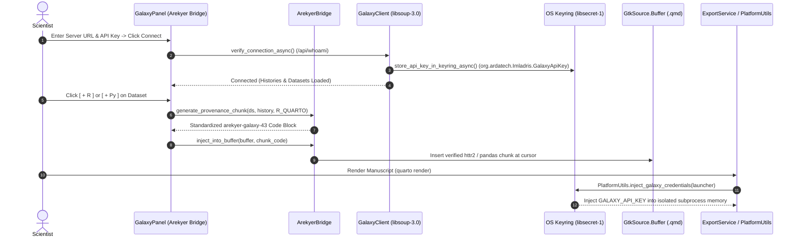

<!--
SPDX-FileCopyrightText: 2026 Antonio De Gaetano <antux912012@users.noreply.github.com>
SPDX-License-Identifier: GPL-3.0-or-later
-->

# Imladris: Architectural Blueprint & Component Connection Map

> **Purpose:** This document provides a complete structural map of **Imladris v0.18.0**, detailing the connections between all UI, computational, bioinformatics bridge, mathematical/chemical parsing, AI, and system layers. Use this guide to understand data flows, identify component responsibilities, and pinpoint the exact source file when debugging issues.

---

## 1. High-Level System Architecture

Imladris is built in **Vala** on **GTK4 + Libadwaita**, with **GtkSourceView 5** for text editing, **WebKitGTK 6.0** for live rendering, **libsoup-3.0 + json-glib-1.0** for asynchronous REST networking, and **libsecret-1** for native OS keyring credential isolation.

```mermaid
flowchart TD
    subgraph UI_Layer ["🖥️ Presentation & UI Shell"]
        APP["Application.vala<br/>(Adw.Application, Action Map)"]
        WIN["Window.vala<br/>(Adw.ApplicationWindow, Ribbon, Tabs)"]
        RIBBON["RibbonFactory.vala & SmartRibbonHelpers.vala<br/>(Dynamic Ribbon Toolbars & Popovers)"]
        PKG_UI["PackagesRibbonBar.vala<br/>(CRAN & PyPI Integrated Ribbon)"]
        DOC["DocumentPage.vala<br/>(Editor, Split Paned, Dock Host)"]
        DOCK["RStudioDockGrid.vala & PersistentPanelRegistry.vala<br/>(4-Quadrant Workbench Layout)"]
        MATH_UI["MathChemEditorDialog.vala<br/>(Natural Math & Chemical Studio)"]
        RPROJ_UI["rproj_dialog.vala & new_project_dialog.vala<br/>(.Rproj & .mallorn Project Creation)"]
        GALAXY_UI["galaxy_panel.vala & galaxy_auth_dialog.vala<br/>(Arekyer Galaxy Bridge UI)"]
        CHAT["AssistantPanel.vala<br/>(Interactive AI Chat & Model Selector)"]
        PREFS["PreferencesDialog.vala & AiSettingsDialog.vala<br/>(Appearance, Elrond AI, Cloud API Keys)"]
    end

    subgraph Editor_Execution ["⚙️ Editor & Execution Subsystem"]
        VIEW["GtkSource.View / Buffer<br/>(Syntax Highlighting, TextTags)"]
        COMPLETION["AiCompletionProvider.vala & CitationCompletionProvider.vala<br/>(Inline AI & Zotero @citekey Completion)"]
        PARSER["ChunkParser.vala<br/>(Code Cell & Option Boundary Scanner)"]
        CHUNK_ENG["ChunkExecutionEngine.vala<br/>(Cell Pipeline & Output Dispatcher)"]
        OUT_WIDGET["InlineChunkOutputWidget.vala<br/>(Embedded Cards, Stdout, Plots)"]
        REPL["ReplBridge.vala<br/>(Persistent Interactive R & Python Stdio)"]
        SESS_MGR["PersistentSessionManager.vala<br/>(Project REPL Lifecycle & PWD Sync)"]
        SHINY["ShinyService.vala & ShinyWindow.vala<br/>(Reactive R Shiny Ephemeral Server)"]
    end

    subgraph Bridges_Domain ["🧬 Arekyer Bioinformatics Bridge & Domain Engines"]
        AREKYER["ArekyerBridge.vala<br/>(Imladris.Bridges.Arekyer Facade)"]
        GALAXY_CL["galaxy_client.vala & galaxy_models.vala<br/>(libsoup-3.0 REST + libsecret-1 Keyring)"]
        GALAXY_GEN["galaxy_chunk_generator.vala<br/>(Standardized httr2 / pandas Synthesis)"]
        MATH_ENG["MathChemEngine.vala<br/>(Natural Math & mhchem -> LaTeX / Markdown)"]
        NB_SER["notebook_serializer.vala<br/>(Jupyter nbformat 4.5 Lossless Round-Trip)"]
        ZOTERO["ZoteroService.vala<br/>(BetterBibTeX .bib & CSL-JSON Indexer)"]
    end

    subgraph AI_Subsystem ["🧠 AI & Elrond Copilot Subsystem"]
        ELROND["ElrondEngineController.vala<br/>(Smart Local AI & Agent Harness Bridge)"]
        AI_CLIENT["AiClient.vala<br/>(Cloud REST Client: Gemini, Claude, OpenAI, etc.)"]
        AI_CFG["AiConfigManager.vala<br/>(API Keys, Models, Endpoints Config)"]
        MCP["McpServer.vala<br/>(Model Context Protocol Stdio Server)"]
    end

    subgraph Core_Services ["📦 Core Services & System Runtime"]
        SETTINGS["SettingsManager.vala<br/>(GSettings + settings.ini)"]
        TOOLCHAIN["ToolchainManager.vala<br/>(4-Tier Runtime Resolution Hierarchy)"]
        MALLORN["MallornManager.vala & project_scaffolder.vala<br/>(.mallorn / .Rproj Scaffold & Packaging)"]
        RECOVERY["RecoveryService.vala<br/>(Shadow Snapshot Auto-Recovery)"]
        EXPORT["ExportService.vala<br/>(Quarto, Pandoc, Typst, ODT/ODP Pipeline)"]
        PKG_CACHE["PackageIndexCache.vala<br/>(CRAN & PyPI ETag Binary-Search Cache)"]
        PLATFORM["PlatformUtils.vala<br/>(Distro Detection, Keyring Injection, flatpak-spawn)"]
    end

    %% Connections
    APP --> WIN
    WIN --> DOC
    WIN --> RIBBON
    WIN --> PKG_UI
    WIN --> MATH_UI
    WIN --> RPROJ_UI
    WIN --> PREFS
    DOC --> VIEW
    DOC --> DOCK
    DOC --> CHAT
    DOC --> RECOVERY
    DOCK --> GALAXY_UI
    GALAXY_UI --> AREKYER
    AREKYER --> GALAXY_CL
    AREKYER --> GALAXY_GEN
    AREKYER --> PLATFORM
    MATH_UI --> MATH_ENG
    RPROJ_UI --> MALLORN
    VIEW --> COMPLETION
    VIEW --> PARSER
    DOC --> CHUNK_ENG
    CHUNK_ENG --> PARSER
    CHUNK_ENG --> REPL
    CHUNK_ENG --> OUT_WIDGET
    REPL --> SESS_MGR
    REPL --> TOOLCHAIN
    COMPLETION --> ELROND
    COMPLETION --> ZOTERO
    CHAT --> AI_CLIENT
    CHAT --> ELROND
    CHAT --> AI_CFG
    ELROND --> PLATFORM
    TOOLCHAIN --> PLATFORM
    EXPORT --> PLATFORM
    DOC --> SETTINGS
    PREFS --> SETTINGS
    PKG_UI --> PKG_CACHE
```



---

## 2. Component Inventory & Responsibility Map

### 2.1 UI & Presentation Layer (`src/`, `src/ui/`)

| Component | File Path | Responsibilities & Connections |
| :--- | :--- | :--- |
| **`Application`** | [`src/Application.vala`](../src/Application.vala) | Root `Adw.Application` singleton (`APP_VERSION = "0.18.0"`). Registers application actions (`app.*`), global accelerators (`Ctrl+M`, `Ctrl+Shift+E`, `Ctrl+Shift+A`, `Ctrl+F1`), and bundled Papirus SVG icon resources. |
| **`Window`** | [`src/Window.vala`](../src/Window.vala) | Main application shell (`Adw.ApplicationWindow`). Coordinates the multi-tier Libadwaita ribbon bar, document tabs (`Adw.TabView`), project status badge, MathChemStudio launcher, and Elrond AI routing. |
| **`RibbonFactory`** | [`src/RibbonFactory.vala`](../src/RibbonFactory.vala) | Declarative factory producing linked tool button groups, collapsible sections, and menu buttons according to Libadwaita design tokens. |
| **`SmartRibbonHelpers`** | [`src/SmartRibbonHelpers.vala`](../src/SmartRibbonHelpers.vala) | Generates interactive popovers for code chunk insertion (`{r}`, `{python}`, `{sql}`), citation keys, LaTeX formulas, and 6x6 table creation grids. |
| **`MathChemEditorDialog`** | [`src/ui/MathChemEditorDialog.vala`](../src/ui/MathChemEditorDialog.vala) | Interactive modal studio (`Ctrl+M`) for natural mathematical formulas and chemical reactions. Provides quick-insert symbol bars, curated scientific presets, live HTML/SVG preview, and 6 output modes (LaTeX Display/Inline/Equation/Align, Markdown `~sub~`/`^sup^`, and Unicode). |
| **`RprojDialog`** | [`src/ui/rproj_dialog.vala`](../src/ui/rproj_dialog.vala) | Native dialog for creating and configuring RStudio-compatible `.Rproj` project manifests with DCF options (`RestoreWorkspace`, `SaveWorkspace`, `Encoding`, `NumSpacesForTab`, `RnwWeave`, `LaTeX`) and optional `renv`/Git initialization. |
| **`GalaxyPanel`** | [`src/ui/galaxy_panel.vala`](../src/ui/galaxy_panel.vala) | Dockable **Arekyer Bridge** inspector panel. Displays remote Galaxy histories and datasets with live state badges (`ok`, `running`, `queued`, `error`), search filtering, and one-click `[ + R ]` and `[ + Py ]` provenance chunk buttons. |
| **`GalaxyAuthDialog`** | [`src/ui/galaxy_auth_dialog.vala`](../src/ui/galaxy_auth_dialog.vala) | Libadwaita preferences dialog for configuring Galaxy server URLs (`usegalaxy.eu`, `usegalaxy.org`, custom), validating API keys via `/api/whoami`, and storing credentials in `libsecret-1`. |
| **`PackagesRibbonBar`** | [`src/ui/PackagesRibbonBar.vala`](../src/ui/PackagesRibbonBar.vala) | Dual-pane CRAN and PyPI package installer bar. Connects to `PackageIndexCache` for real-time autocompletion and calls `pak` or `uv` via `ToolchainManager`. |
| **`DocumentPage`** | [`src/DocumentPage.vala`](../src/DocumentPage.vala) | Active document container. Manages single-pane writer view vs 4-quadrant RStudio workbench, cell navigation (`Shift+Enter`), and debounced shadow buffer backups. |
| **`PersistentPanelRegistry`** | [`src/ui/PersistentPanelRegistry.vala`](../src/ui/PersistentPanelRegistry.vala) | Caches singleton widgets (Console, Terminal, WebKit Preview, Environment, Files, Plots, History, Packages, Help, Citations, Arekyer Bridge, Shiny Viewer) across tab switches. |
| **`RStudioDockGrid`** | [`src/ui/RStudioDockGrid.vala`](../src/ui/RStudioDockGrid.vala) | Implements the four-quadrant split layout with draggable paned dividers and layout presets. |
| **`DataGridViewer`** | [`src/ui/DataGridViewer.vala`](../src/ui/DataGridViewer.vala) | High-performance `Gtk.ColumnView` inspector for R and Python dataframes with sorting, regex filtering, and clipboard export. |
| **`ShinyWindow`** | [`src/ui/ShinyWindow.vala`](../src/ui/ShinyWindow.vala) | Dedicated `Adw.Window` hosting live WebKitGTK 6.0 sessions for reactive R Shiny applications. |

---

### 2.2 Arekyer Bioinformatics Bridge & Domain Engines (`src/bridges/`, `src/core/`)



| Component | File Path | Responsibilities & Connections |
| :--- | :--- | :--- |
| **`ArekyerBridge`** | [`src/bridges/ArekyerBridge.vala`](../src/bridges/ArekyerBridge.vala) | High-level facade in `Imladris.Bridges.Arekyer`. Coordinates `GalaxyClient`, `GalaxyChunkGenerator`, `GtkSource.Buffer` injection, and `GLib.SubprocessLauncher` credential injection. |
| **`GalaxyClient`** | [`src/bridges/galaxy_client.vala`](../src/bridges/galaxy_client.vala) | Asynchronous REST client (`libsoup-3.0`, `json-glib-1.0`) querying `/api/whoami`, `/api/histories`, and `/api/histories/{id}/contents`. Integrates `libsecret-1` (`org.ardatech.Imladris.GalaxyApiKey`) for OS keyring storage and GDPR erasure. |
| **`GalaxyChunkGenerator`** | [`src/bridges/galaxy_chunk_generator.vala`](../src/bridges/galaxy_chunk_generator.vala) | Synthesizes WIKI 02 standardized R (`httr2` + `readr`) and Python (`requests` + `pandas`) code chunks with `# AREKYER PROVENANCE RECORD` metadata headers and binary dataset local caching. |
| **`GalaxyModels`** | [`src/bridges/galaxy_models.vala`](../src/bridges/galaxy_models.vala) | GObject models (`GalaxyHistory`, `GalaxyDataset`, `GalaxyDatasetState`, `TargetLanguage`) for binding directly to `GLib.ListStore` and `Gtk.ListView`. |
| **`MathChemEngine`** | [`src/core/MathChemEngine.vala`](../src/core/MathChemEngine.vala) | Deterministic parser converting natural mathematical syntax (fractions, integrals, sums, roots, matrices, Greek identifiers) and chemical notation (stoichiometry, states, reaction arrows `->[cat][cond]`, ions, hydrates) into LaTeX (`\ce{...}`) or Markdown (`~sub~`/`^sup^`). |
| **`NotebookSerializer`** | [`src/core/notebook_serializer.vala`](../src/core/notebook_serializer.vala) | Bidirectional Jupyter `.ipynb` (`nbformat 4.5`) serializer preserving cell IDs, `execution_count`, `tags`, `raw` cells, and custom notebook/cell metadata via hidden HTML comment anchors. |

---

### 2.3 Computation & Execution Subsystem (`src/console/`, `src/editor/`, `src/services/`)

| Component | File Path | Responsibilities & Connections |
| :--- | :--- | :--- |
| **`ReplBridge`** | [`src/console/ReplBridge.vala`](../src/console/ReplBridge.vala) | Manages long-running interactive REPL subprocesses (`R --interactive`, `python -i -u`). Injects prompt sentinels, captures graphics devices (PNG), and enforces project-root `pwd` locking. |
| **`ChunkExecutionEngine`** | [`src/editor/ChunkExecutionEngine.vala`](../src/editor/ChunkExecutionEngine.vala) | Dispatches chunk execution (`Ctrl+Shift+Enter` or `Shift+Enter`), parses options (`#| echo: false`), routes code to `ReplBridge`, and mounts `InlineChunkOutputWidget`. |
| **`ChunkParser`** | [`src/core/ChunkParser.vala`](../src/core/ChunkParser.vala) | Zero-copy scanner for fenced markdown code chunks (````{r}`, ````{python}`, ````{julia}`, ````{sql}`, ````{bash}`) and Quarto chunk headers. |
| **`PersistentSessionManager`** | [`src/services/PersistentSessionManager.vala`](../src/services/PersistentSessionManager.vala) | Project-scoped singleton ensuring variables, loaded libraries, and dataframes survive across multiple chunk runs. |
| **`ShinyService`** | [`src/services/ShinyService.vala`](../src/services/ShinyService.vala) | Detects Shiny applications, allocates ephemeral localhost ports, spawns `Rscript`, intercepts listening URLs, and routes display to Quadrant 4, `ShinyWindow`, or external browser. |
| **`ZoteroService`** | [`src/services/ZoteroService.vala`](../src/services/ZoteroService.vala) | Parses local BetterBibTeX `.bib` and CSL-JSON files and feeds `CitationCompletionProvider` for live `@citekey` completion. |
| **`SandboxController`** | [`src/services/SandboxController.vala`](../src/services/SandboxController.vala) | Interacts with project virtual environments (`.venv`, `renv`, `.imladris-env`) and synchronizes lockfiles. |

---

### 2.4 Core Services & System Runtime Layer (`src/core/`, `src/services/`, `src/adapters/`)

| Component | File Path | Responsibilities & Connections |
| :--- | :--- | :--- |
| **`SettingsManager`** | [`src/core/SettingsManager.vala`](../src/core/SettingsManager.vala) | Persistent application settings via `GLib.Settings` and `~/.config/imladris/settings.ini`. |
| **`ToolchainManager`** | [`src/core/ToolchainManager.vala`](../src/core/ToolchainManager.vala) | Resolves R, Python, Quarto, and Typst runtimes via a 4-tier priority hierarchy (`.imladris-env` $\rightarrow$ managed micromamba $\rightarrow$ host $\rightarrow$ setup dialog). |
| **`MallornManager`** | [`src/core/MallornManager.vala`](../src/core/MallornManager.vala) | Parses and writes `.mallorn` and `.Rproj` DCF project manifests and packages reproducible `.tar.zst` archives. |
| **`ProjectScaffolder`** | [`src/core/project_scaffolder.vala`](../src/core/project_scaffolder.vala) | Scaffolds multi-file project directories, `.Rproj` files, `.gitignore`, `README.md`, and initial notebooks. |
| **`RecoveryService`** | [`src/services/RecoveryService.vala`](../src/services/RecoveryService.vala) | Asynchronous shadow snapshot engine saving unsaved buffer states to `~/.cache/imladris/recovery/`. |
| **`ExportService`** | [`src/services/ExportService.vala`](../src/services/ExportService.vala) | Renders documents to HTML, PDF, ODT, and ODP using Quarto, Pandoc, or LibreOffice with isolated `GALAXY_API_KEY` injection. |
| **`PlatformUtils`** | [`src/core/PlatformUtils.vala`](../src/core/PlatformUtils.vala) | Detects Linux distribution, resolves Flatpak host portals (`flatpak-spawn --host`), and injects keyring credentials (`inject_galaxy_credentials`) into subprocess launchers. |
| **`DocumentAdapter`** | [`src/adapters/DocumentAdapter.vala`](../src/adapters/DocumentAdapter.vala) | Normalizes `.md`, `.qmd`, `.Rmd`, `.ipynb`, `.R`, and `.py` into standard editor buffers and renders live HTML/KaTeX/mhchem previews. |

---

## 3. Bug Localization & Diagnostic Matrix

| Symptom / Failure Mode | Primary Subsystem | Primary Source Files | How to Diagnose & Verify |
| :--- | :--- | :--- | :--- |
| **Galaxy connection fails or histories do not load** | Arekyer Bridge | [`src/bridges/galaxy_client.vala`](../src/bridges/galaxy_client.vala)<br/>[`src/ui/galaxy_auth_dialog.vala`](../src/ui/galaxy_auth_dialog.vala) | Verify server URL starts with `https://` and API key is valid via `curl -H "x-api-key: <KEY>" https://usegalaxy.eu/api/whoami`. Run `meson test galaxy_bridge_tests`. |
| **`GALAXY_API_KEY` missing during `quarto render`** | Subprocess / Keyring | [`src/core/PlatformUtils.vala`](../src/core/PlatformUtils.vala)<br/>[`src/bridges/ArekyerBridge.vala`](../src/bridges/ArekyerBridge.vala) | Check `PlatformUtils.inject_galaxy_credentials()`. Verify `org.freedesktop.secrets` service is active or `GALAXY_API_KEY` is set in environment. |
| **Math or chemical formula conversion mismatch** | MathChem Engine | [`src/core/MathChemEngine.vala`](../src/core/MathChemEngine.vala)<br/>[`src/ui/MathChemEditorDialog.vala`](../src/ui/MathChemEditorDialog.vala) | Inspect `convert_math_to_latex()` or `convert_chem_to_mhchem()`. Run `meson test mallorn_sandbox_tests` to verify formula test cases. |
| **`.ipynb` cell metadata or raw cells lost on save** | Notebook Serializer | [`src/core/notebook_serializer.vala`](../src/core/notebook_serializer.vala) | Check `<!-- imladris-cell: {...} -->` comment preservation in `markdown_to_ipynb()` and `ipynb_to_markdown()`. |
| **Code chunks hang or fail to execute** | Execution / REPL | [`src/console/ReplBridge.vala`](../src/console/ReplBridge.vala)<br/>[`src/editor/ChunkExecutionEngine.vala`](../src/editor/ChunkExecutionEngine.vala) | Check terminal stdout/stderr. Verify that the interpreter (`R` or `python3`) starts properly on the host/sandbox and sentinel markers resolve. |
| **Local Elrond AI / Server Bridge offline** | AI Subsystem | [`src/ai/ElrondEngineController.vala`](../src/ai/ElrondEngineController.vala)<br/>[`src/ui/PreferencesDialog.vala`](../src/ui/PreferencesDialog.vala) | Probe local server (`curl http://127.0.0.1:11434/api/tags` or `127.0.0.1:8088/health`). Click "Probe Servers" in Preferences. |

---

## 4. Architectural Conventions & Guidelines

1. **ASD-STE100 Documentation:** All documentation, comments, and UI messages follow Simplified Technical English (active voice, unambiguous terms).
2. **Non-Blocking UI Thread:** Network I/O (`libsoup-3.0`), keyring lookups (`libsecret-1`), subprocess execution, and disk snapshots run asynchronously on GLib worker threads or async main-loop callbacks.
3. **Zero Plain-Text Credentials:** Cloud bioinformatics tokens (`GALAXY_API_KEY`) are never written into `.qmd`, `.Rmd`, or `.ipynb` files; they reside in `libsecret-1` and are injected exclusively into isolated child process memory spaces.
4. **Beyonce Rule Testing:** Every domain feature (Arekyer chunk synthesis, MathChem conversion, `.Rproj` scaffolding, `.ipynb` parity, Zotero, Shiny, Docking) is verified by automated Meson unit test suites (`7/7 OK`).
