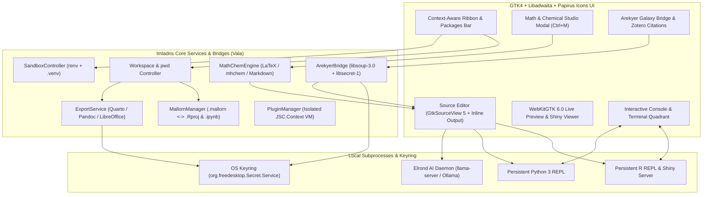

<!--
SPDX-FileCopyrightText: 2026 Antonio De Gaetano <antux912012@users.noreply.github.com>
SPDX-License-Identifier: GPL-3.0-or-later
-->

# Welcome to the Imladris IDE Wiki

**Imladris (`v0.25.0`)** is a native Linux scientific authoring, bioinformatics provenance, and polyglot notebook IDE built with **Vala**, **GTK4**, **Libadwaita**, **GtkSourceView 5**, and **WebKitGTK 6.0**. Designed for researchers, bioinformaticians, statisticians, and data scientists, Imladris combines the reproducibility of RStudio and Jupyter with a modern GNOME HIG-compliant interface, the **Arekyer Galaxy-to-Quarto Provenance Bridge**, the **Natural Math & Chemical Reaction Studio**, 100% local Vulkan-accelerated AI assistance (**Elrond**), Free-Tier AI orchestration, GitHub Copilot OAuth, and an Obsidian-style JavaScript extension ecosystem (`JSC.Context`).

> [!TIP]
> 🌐 **Visit the Official Project Landing Page:** [https://antux912012.github.io/imladris/](https://antux912012.github.io/imladris/)  
> **New to Imladris?** Start with the [[Installation and Building|Installation-and-Building]] guide or jump straight into [[Arekyer: Galaxy-to-Quarto Bridge|Galaxy-to-Quarto-Bridge]] and [[Projects and Sandboxing|Projects-and-Sandboxing]].

---

## Core Feature Matrix

| Pillar | Feature | Description |
| :--- | :--- | :--- |
| **Bioinformatics Bridge** | **Arekyer (`WIKI 02`)** | Connects upstream **Galaxy Project** histories (`usegalaxy.eu`, `usegalaxy.org`) to local `.qmd` and `.Rmd` files. Injects verifiable `httr2` (R) and `pandas` (Python) loaders while storing API keys in the OS keyring (`libsecret-1`). |
| **Structural Biology Bridge** | **Taniquetil** | Inspects 3D macromolecular structures from DeepMind **AlphaFold DB** and RCSB PDB with interactive Cairo pLDDT confidence tracks, injecting reproducible `bio3d` (R) and `biotite` (Python) code blocks. |
| **Bio-Entity Resolver** | **Yavanna** | Resolves UniProtKB protein accessions and Ensembl GRCh38 coordinates asynchronously, calculating DNA/RNA sequence metrics, GC content, $T_m$, and reverse-complement tables. |
| **Clinical Biostatistics** | **Elbereth** | Computes ICH E9 statistical sample sizes, Schoenfeld log-rank survival power, and Cairo power curves ($1-\beta$ vs. $N$), generating CDISC ADSL Table 1 and ADTTE Kaplan-Meier code blocks. |
| **Scientific Notation** | **Math & Chem Studio (`Ctrl+M`)** | Translates natural mathematical expressions (`int(0, inf) e^(-x^2) dx`) and chemical reactions (`6CO2(g) + 6H2O(l) ->[h*nu] C6H12O6(aq) + 6O2(g)`) into LaTeX (`$$...$$`, `\ce{...}`) or Markdown (`~sub~`/`^sup^`). |
| **Workspaces & Portability** | **Standard, Sandboxed & `.Rproj`** | Creates multi-file `.Rmd`, `.qmd`, `.ipynb`, or native RStudio `.Rproj` projects bound either to host libraries or isolated inside `renv` (R) and `.venv` (Python) sandboxes. |
| **1:1 RStudio & Jupyter** | **`.mallorn` & `nbformat 4.5`** | Native `.mallorn` / `.Rproj` synchronization and lossless Jupyter `.ipynb` round-trip serialization (cell IDs, execution counts, tags, raw cells, and `Shift+Enter` cell advancement). |
| **Interactive Compute** | **Live REPL & R Shiny** | Persistent bidirectional `R` and `Python 3` consoles with inline chunk stdout, `Gtk.ColumnView` dataframe viewer, plot gallery, and live R Shiny web application hosting (`Ctrl+Shift+A`). |
| **Package Management** | **Packages Ribbon Bar** | Dedicated top Ribbon tab featuring on-demand CRAN and PyPI search autocomplete, `uv`/`pak` acceleration, plus GitHub (`owner/repo`) and local archive (`.tar.gz`, `.whl`) installations. |
| **Local AI Copilot** | **Elrond Assistance (AI)** | Direct Editor Writing (`Ctrl+Shift+E`), local AI (`llama-server`, Ollama, LM Studio), Free-Tier APIs (Groq, Cerebras, OpenRouter `:free`, GitHub Models, FreeLLMAPI), Automatic Quota Failover, GitHub Copilot OAuth login, and hardened MCP stdio server (`--mcp-server`). |
| **Scientific Publishing** | **ODT, ODP, PDF & HTML** | Native export pipelines via Quarto, RMarkdown, Pandoc, and headless LibreOffice for OpenDocument Text (`.odt`) and Presentations (`.odp`). |
| **Community Plugins** | **`.implugin` Extensions** | Obsidian-style third-party plugins written in JavaScript (`JSC.Context`) using declarative Libadwaita UI builders and **Papirus** symbolic icons. |

---

## System Architecture Overview

---

## Quick Navigation

### 1. Getting Started
* [[Installation and Building|Installation-and-Building]] — Flatpak setup, Meson/Ninja compilation, and required libraries (`libsecret-1`, `gtk4`, `libadwaita-1`, `webkitgtk-6.0`).
* [[Projects and Sandboxing|Projects-and-Sandboxing]] — Understanding Standard vs. Sandboxed projects, `.Rproj` creation, and automatic `pwd` root locking.
* [[Mallorn Format, RStudio and Jupyter Parity|Mallorn-Format-and-RStudio]] — Sharing `.mallorn` bundles, `.Rproj` synchronization, and Jupyter `nbformat 4.5` lossless parity.

### 2. Core Scientific Workflows
* [[WIKI 02 // Arekyer: Galaxy-to-Quarto Provenance Bridge|Galaxy-to-Quarto-Bridge]] — Connecting remote Galaxy bioinformatics histories (`usegalaxy.eu`) to reproducible `.qmd` and `.Rmd` manuscripts.
* [[WIKI 03 // Natural Math and Chemical Reaction Studio|Math-and-Chemical-Studio]] — Writing natural math formulas and chemical equations (`Ctrl+M`) with LaTeX and Markdown output.
* [[Packages Ribbon Manager|Packages-Ribbon-Manager]] — Installing R (CRAN) and Python (PyPI) packages, GitHub repos, and local archives directly from the Ribbon.
* [[Exporting ODT, ODP, PDF and HTML|Exporting-ODT-ODP-PDF]] — Rendering documents and slide decks to OpenDocument and publication formats.

### 3. Elrond Assistance (AI) & Extensions
* [[Elrond Local AI Copilot|Elrond-Local-AI-Copilot]] — Local LLM setup, `Low`/`Medium`/`High` assistance modes, and dataframe schema awareness.
* [[Plugin Development Guide|Plugin-Development-Guide]] — Build your first `.implugin` extension in 5 minutes using JavaScript.
* [[Plugin API Reference|Plugin-API-Reference]] — Complete documentation for the `imladris.*` JavaScriptCore bridge.
* [[Architecture and HIG|Architecture-and-HIG]] — Technical design notes and GNOME Human Interface Guidelines compliance.
* [[License and GPLv3|License-and-GPLv3]] — GNU GPLv3 terms and the Script Interface Exception for third-party plugin authors.
