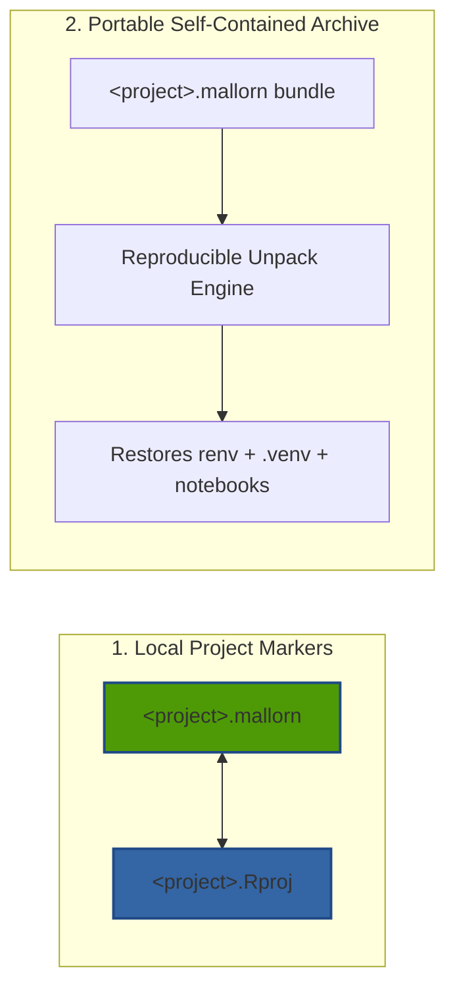

<!--
SPDX-FileCopyrightText: 2026 Antonio De Gaetano <antux912012@users.noreply.github.com>
SPDX-License-Identifier: GPL-3.0-or-later
-->

# The `.mallorn` Format, Native `.Rproj` Scaffolding & Jupyter `nbformat 4.5` Parity

Imladris introduces the **`.mallorn`** specification and bidirectional serializers to solve a fundamental problem in scientific publishing: creating a project format that is native to modern Linux and GNOME while preserving **100% byte-for-byte interoperability with RStudio (`.Rproj`) and Jupyter Notebook (`.ipynb`)**.

---

## 1. Dual Nature of the `.mallorn` & `.Rproj` Formats

The `.mallorn` specification operates in two distinct modes:



### Mode 1: Local Project Marker (`<name>.mallorn` & `<name>.Rproj`)
Inside any Imladris workspace folder, Imladris writes a `<name>.mallorn` file using RStudio's **Debian Control File (DCF)** key-value syntax alongside a synchronized `<name>.Rproj` manifest.

You can also create standalone RStudio `.Rproj` projects directly from **File $\rightarrow$ New RStudio Project (`.Rproj`)…** (`RprojDialog`), configuring:
- `RestoreWorkspace` (`Yes` / `No` / `Default`)
- `SaveWorkspace` (`Yes` / `No` / `Default`)
- `AlwaysSaveHistory` (`Yes` / `No` / `Default`)
- `UseSpacesForTab` and `NumSpacesForTab` (`2`, `4`, `8`)
- `Encoding` (`UTF-8`)
- `RnwWeave` (`knitr` / `Sweave`) and `LaTeX` (`pdfLaTeX` / `XeLaTeX` / `LuaLaTeX`)
- Optional automatic `renv` initialization and Git repository scaffolding.

#### Sample `.mallorn` / `.Rproj` File Specification
```dcf
Version: 1.0
RestoreWorkspace: No
SaveWorkspace: No
AlwaysSaveHistory: Default

EnableCodeIndexing: Yes
UseSpacesForTab: Yes
NumSpacesForTab: 2
Encoding: UTF-8

RnwWeave: knitr
LaTeX: pdfLaTeX

ImladrisVersion: 0.18.0
ImladrisProjectType: Sandboxed
ImladrisTarget: Quarto
ImladrisPythonEnv: .venv
ImladrisRenvActive: Yes
```

All keys prefixed with `Imladris*` are ignored by standard RStudio while providing extended workspace metadata to Imladris.

---

## 2. Mode 2: The Portable `.mallorn` Exchange Archive

When sharing code with peer reviewers or colleagues, standard `.zip` files often fail because huge local folders (`renv/library/`, `.venv/`, `.git/`, `.cache/`) are either accidentally included or critical lockfiles are missed.

### Exporting a `.mallorn` Archive
In the Ribbon under **Publish $\rightarrow$ .mallorn**:
1. Imladris gathers all notebooks (`.qmd`, `.Rmd`, `.ipynb`), scripts (`.R`, `.py`), configuration files, and datasets.
2. It captures the exact dependency state in `renv.lock` and `requirements.txt`.
3. It strips non-portable binaries, `.venv/bin/`, and local object caches.
4. It packages the workspace into a compressed `.mallorn` tarball (`tar.zst` with high-ratio Zstandard compression).

---

## 3. Jupyter Notebook (`nbformat 4.5`) Full Parity

Imladris provides lossless bidirectional serialization between Jupyter `.ipynb` JSON documents and the GtkSourceView editor buffer via `NotebookSerializer`:

| Jupyter `nbformat 4.5` Feature | Imladris Representation & Preservation |
| :--- | :--- |
| **Code Cells (`"cell_type": "code"`)** | Editable fenced code blocks (````{python}`, ````{r}`, ````{julia}`) with language kernel routing. |
| **Markdown Cells (`"cell_type": "markdown"`)** | Native Markdown prose blocks separated by cell boundaries. |
| **Raw Cells (`"cell_type": "raw"`)** | Preserved losslessly as ` ```{raw} ` blocks and restored to `"cell_type": "raw"` on save. |
| **Cell IDs (`"id": "cell-abc123"`)** | Preserved across load/save cycles via `<!-- imladris-cell: {"id": ...} -->` metadata anchors; deterministic IDs generated if absent. |
| **Execution Counts & Tags** | `execution_count` and `metadata.tags` (such as `parameters`, `hide-input`) round-trip without loss. |
| **Kernel Metadata** | Supports Python (`python3`), R (`ir`), and Julia (`julia-1.10`) `kernelspec` and `language_info` headers. |
| **`Shift+Enter` Cell Workflow** | Executes the current cell via `ChunkExecutionEngine` and automatically advances the cursor to the next code cell (or inserts a new cell at the end of the notebook). |

---

## 4. Dedicated RStudio and Jupyter Exporting

In addition to `.mallorn` bundles, the **Publish** ribbon includes direct export bridges:
- **Export for RStudio**: Generates a clean RStudio project bundle with `.Rproj`, `renv/activate.R`, `.Rprofile`, and a standardized `run_all.R` harness.
- **Export for Jupyter Notebook**: Exports workspace notebooks along with `environment.yml`, `requirements.txt`, and an automated virtual environment bootstrap script.
